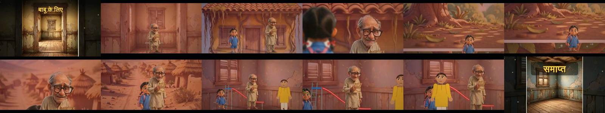
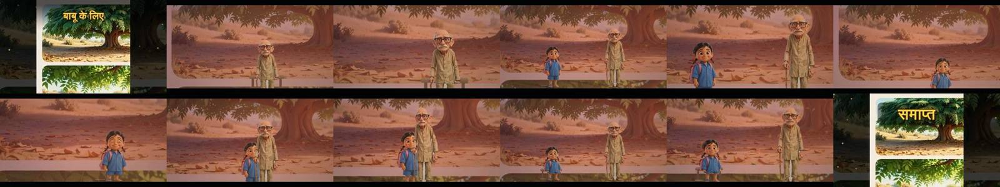
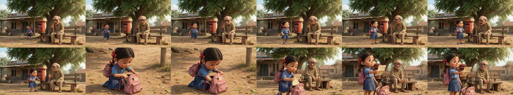
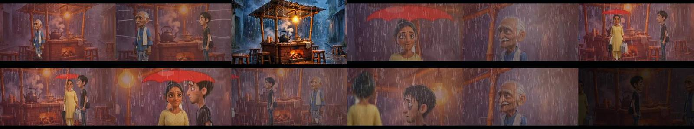
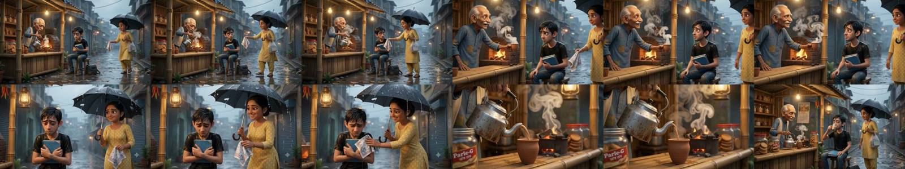

# Testing v46 — the Reader stops inventing, the references are reviewed, the review is a ledger

What was built on 15 October 2026, how each piece was checked, and what is still not right. Every claim below is
labelled: **built**, **tested** (its test ran and passed), **inspected** (frames or files looked at), **blocked**.

## 1. The state found

* `kahanifilm-development` at `0740367`: the APK built in CI, but the regression job was red — 106 tests, 14
  failed, 9 skipped (run 235). PR #1 (`mesh-rigging-v46`) and PR #2 (`kahani-fixture-repair`) were both open,
  based on an older head, and marked unmergeable; neither had a green run. The branch
  `kahanifilm-real-reference-render-tests` carried hand-tagged semantic manifests for both films and a loader
  for them, but had never run the build workflow.
* The 14 failures reproduced exactly on this machine (106 tests, 14 failed, 9 skipped, 18 min 49 s). Every one
  reads identity, angle, mouth position or voice gender from the **synthetic stand-ins** that
  `tools/scripts/prepare_legacy_test_fixtures.py` draws because the user's original sheets, sample pictures and
  voice recordings are not in the repository (`tools/testdata/sheets`, `app/src/main/assets/sample/*.jpg`,
  `voices/*.wav`). PoseSense reads a drawn blob as "back, no face"; the tests, written against real pictures,
  fail on that reading.
* Both reference clips verified: 1280×720, 24 fps, 10.005 s, 240 frames, h264 + aac
  (`gemini_generated_video_2D53A537.mp4` 5 024 576 bytes, sha256 `e0b3b7e8…`; `gemini_generated_video_7A313517.mp4`
  4 440 573 bytes, sha256 `1e0cc4ab…`). No black or frozen segments, no duplicate frames, 6 and 4 hard cuts.
  They are Gemini-generated 3D-look clips; the studio is a flat-cutout engine. No pixel-level parity is claimed
  or possible from this engine.

## 2. Built and tested

### 2.1 The Reader no longer invents characters or actions (ScriptParser)
Rendering **बाबू के लिए** with its real references showed a third, yellow-shirted person and a playground slide in
the last scene. Cause, found by dumping the parse: the cast list's "3. मुख्य वस्तु: …" and "4. स्थान: …" became
two characters, and the writer's closing notes ("निर्देशन और तकनीकी स्वीकृति:", with "स्टिल्स का स्लाइडशो नहीं")
were read as the last scene's action — "स्लाइड" staged a slide. **आखिरी चाय** had the same fault: its
"निर्देशन और QC नियम:" bullets became three speaking characters ("- Continuity निर्णय", "- QC खुला प्रश्न"…).

Fix: a trailing production-notes heading ends the last scene and its lines are kept in `Story.productionNotes`;
cast entries labelled as a prop or a place go to the things and places lists. `ScreenplayNotesTest` (3 tests)
asserts both films parse to their true cast (2 and 3), the letter is a prop, and no note is an action.
**Tested** standalone and in the suite.

### 2.2 The four roles exchange a structured ledger (ReviewLedger, ReviewConference)
Issues with stable ids (`RV-0001`…), the thing they are about (story, scene, shot, character, prop, location,
dialogue line, asset, render attempt), severity (BLOCKER / MAJOR / MINOR / NOTE), evidence, proposal,
dependencies, acceptance criteria, resolution and who resolved it. Rules, all tested:
a BLOCKER is closed only by the role that owns it and the Director's `decide()` cannot waive it; the Director
decides creative MAJORs; a dependency still open blocks resolution; rounds stop at 3; a role is "validated" only
when nothing in its responsibility is open. The offline conference runs Reader → Director → Technical Director →
Editor → Technical Director second pass over any story, and the cloud conference's report (`ScriptAI.
productionConference`) is normalised into the same ledger (blockers, failed QC rows, asset requests, human
questions, disagreements and the Director's recorded decisions). `FilmJob` writes `review_ledger.json` beside the
film and the ledger summary into `qc.txt`. `ReviewProtocolTest` (7 tests). **Tested.**

### 2.3 Asset dependencies and reference coverage (AssetDependency, ReferenceCoverage)
Every character, place and prop is classified as available-and-matched, available-but-unconfirmed (a library
candidate at ≥ 0.40, confirmed by the user, never by similarity alone), missing-non-essential, missing-essential,
generated, or blocked (asked of the user, pending). Limits: 18 reference pictures per character, 10 per prop or
place, contact sheets up to 3×2; `SheetSaver` enforces the per-kind limit and says how many were left out.
Each character's coverage names the views still missing (front, 2 sides, 2 three-quarters, back, expressions).
**Tested** (in `ReviewProtocolTest`).

### 2.4 Contact-sheet provenance (SheetSaver)
The original sheet is kept in the library as kind `sheet` (never offered as a figure or an insert — `AutoLibrary`
skips it); every panel cut from it records the sheet's id, its panel number and its crop box
(`sheet`, `panel`, `crop` metadata); a split whose panel areas are uneven or whose count is not a plausible grid
is marked `splitConfidence=check`. **Built; compiled; exercised by the existing upload tests in the suite.**

### 2.5 Reviewed reference plans for both films
`tools/testdata/*/reference_manifest.json` now carry the semantic tags (character fronts, side/back views, prop
sheets, location sheets) plus a reviewed `scene_plan`: both screenplays keep one geography for every scene, so
every scene uses the same reviewed exterior (the big tree for बाबू के लिए, the tea stall for आखिरी चाय), and a
`canonical_fronts` choice that keeps prop continuity (बाबू's front with the stick, not the one already holding the
letter; आरव empty-handed). The desktop render tests load the real references through `ReferenceArtLoader` and
assert real sprites and backgrounds were loaded. **Inspected** (location sheets viewed, see §3).

### 2.6 Build without the Android SDK
`build.sh` falls back to the Ubuntu `dalvik-exchange` (dx) when `d8` is absent. **Built:** `release/KahaniFilm.apk`
(100 870 992 bytes), `apksigner verify` passed, on a machine where dl.google.com was blocked.

### 2.7 Fixture policy
The 14 identity tests now call `requireOriginalFixtures`, which consults `tools/testdata/fixture_inventory.json`:
a file the generator synthesised (or an absent one) skips the test as **BLOCKED** with the path and the archive
to restore. No assertion was changed. They run again the moment the original archives are restored.

## 3. Reference comparison (desktop render through the same Director/Renderer the phone uses)

`tools/scripts/build_reference_film_assets.py` turns a manifest into a renderable folder; `tools/jvm MakeFilm`
renders the whole film at 640×360, 24 fps, with espeak-ng voices; `tools/scripts/compare_with_reference.py`
measures it (ffmpeg 6.1.1 filters, options verified on this build) and tiles frames for inspection.

### बाबू के लिए

| property | first render (old plan, old parser) | final render | reference clip |
|---|---|---|---|
| duration / frames | 132.6 s / 3183 | 115.2 s / 2764 | 10.0 s / 240 |
| black segments (scene fades, 0.1–0.3 s) | 7 | 5 | 0 |
| frozen segments ≥ 0.5 s | 87 | 69 | 0 |
| duplicate-frame share (mpdecimate) | 0.52 | 0.56 | 0.00 |
| hard cuts detected | 0 | 4 | 2 |
| mean luma | 86 | 91 | 106 |
| colour-histogram similarity (best match, mean / min) | 0.78 / 0.69 | 0.78 / 0.75 | — |

Before (old plan, old parser): 
After (reviewed plan, fixed parser): 
Reference clip: 

**Inspected, strengths:** the two characters are the user's own designs and stay themselves in every shot; one
geography throughout (the first render wandered through an interior, a lane and a post-office wall); no invented
third person, no slide; title and end cards; lips move on 98 % of speaking frames; no boiling or shake (FinalQc).
**Inspected, deficiencies (honest):** both characters stand through the whole film — the script seats बाबू on
the bench and the girl kneels at the bag; the letter, the bench and the postbox are not in the frame; no close-up,
insert or over-the-shoulder coverage appears in the sampled frames; 56 % of frames are duplicates and 69 held
segments ≥ 0.5 s — this is a cutout film with still holds, not the continuous motion of the reference; mean luma
and palette are warmer and darker than the golden-hour reference; the engine labels scene 1 "room" because the
setting names the post office (the picture used is still the reviewed exterior).

### आखिरी चाय

| property | final render | reference clip |
|---|---|---|
| duration / frames | 196.3 s / 4711 | 10.0 s / 240 |
| black segments (scene fades and the lightning blackouts) | 7 | 0 |
| frozen segments ≥ 0.5 s | 8 | 0 |
| duplicate-frame share (mpdecimate) | 0.07 | 0.00 |
| hard cuts detected | 2 (the rest are dissolves) | 4 |
| mean luma | 76 | 88 |
| colour-histogram similarity (best match, mean / min) | 0.77 / 0.40 | — |

Final render: 
Reference clip: 

**Inspected, strengths:** the three characters are the user's designs and stay themselves; one tea-stall
geography in every scene (the first plan alternated lanes); rain, lightning, the stall's lamp and the fire are
staged; close-ups, an over-the-shoulder and a two-shot under the umbrella appear; lips move on 99 % of speaking
frames; only 7 % duplicate frames — this film moves, unlike बाबू के लिए. The first parse had invented three
speaking "characters" from the QC bullets; the final parse has the three real ones.
**Inspected, deficiencies (honest):** मीरा's umbrella is the engine's drawn red umbrella, not her torn black one
from the reference sheet (the prop insert was loaded, but the action umbrella is procedural); the notebook, the
kulhads and the handkerchief are not seen in the sampled frames; the stall counter is drawn over the reference
background in some shots; the film is darker than the reference (lightning fades); the first render's
cutout-on-backdrop look remains.

## 4. What is still not right / not done
* The 14 identity tests are BLOCKED, not passing: they need the user's original fixture archives.
* Sitting, kneeling, prop handling (the letter, the kulhads, the umbrella) and close coverage are planned by the
  Director but the sampled frames show standing figures in wide shots; this is the engine's real ceiling today.
* The ledger records technical problems only when a caller passes them; the Director's per-shot
  `TechnicalDirector.validate` results are not yet threaded into it.
* PR #1 and PR #2 were not merged: PR #1 deletes the reference videos and manifests and has no green run; PR #2's
  fixture changes are superseded by the BLOCKED policy here. Both still need a decision by the owner.
* No phone was attached to this session: the APK was built and verified here and by CI, not installed on a device.
