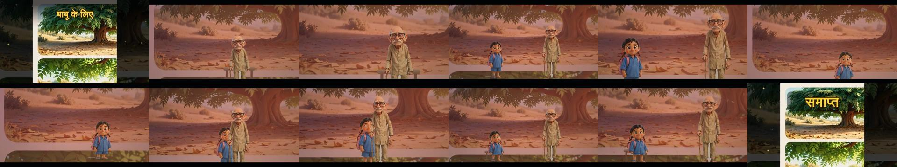
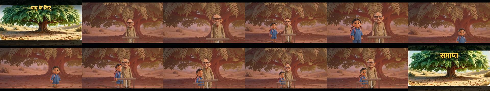
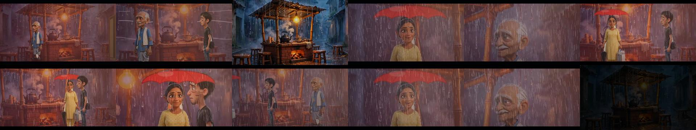
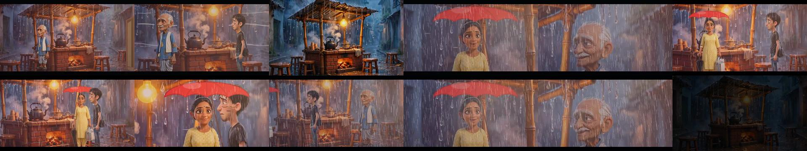
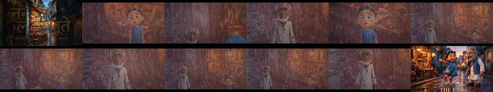

# Testing v47 — seats that stay, sheets cut at their gutters, a third story from the filmmaker's own uploads

What was built on 15 October 2026 after v46, how each piece was checked, and what is still not right. Every claim is
labelled **built**, **tested** (its test ran and passed), **inspected** (frames or files looked at), or **blocked**.

## 1. What the v46 record said was wrong, and why

* *"both characters stand through the whole film — the script seats बाबू on the bench"*: the Director seated him in
  scene 1 and stood him up at the start of scenes 2, 4 and 5. Every part began from a standing line-up; only sleep
  carried over between parts. The scene plan keeps one geography, so the bench was there — he just never sat on it.
* The scene backdrops showed a rounded corner and a white gutter: the desktop builders cut every contact sheet as
  an even 3×2 grid, but the big-tree sheet is not an even grid, so each "panel" was one whole panel plus a third of
  the next, with the sheet's paper between them.

## 2. Built and tested

### 2.1 Seats carry over between parts (Director)
A character seated on furniture (a bench, a chair, a stool, a sofa, a log) when a part ends is still seated there
when the next part opens in the same place — the same picture of the place, or without pictures the same kind of
place. The script stands them up; the film never does on its own. A character left out of a part (बाबू is not in
scene 3, the girl's close shot) keeps the seat for the part after it. "(उनके पास बैठते हुए)" in a line's manner
seats the speaker beside them on the same bench. `SeatContinuityTest.babuStaysOnHisBenchThroughTheFilm` — directed
from the real references — asserts बाबू is seated on the bench in all four parts he is in and the girl sits beside
him in scenes 4 and 5. **Tested.**

### 2.2 Sheets are cut at their gutters (Angles.sheetPanels, Art.panelInset)
`Angles.sheetPanels` finds a contact sheet's panels from the gutters of the sheet's own colour (nine tenths of a row
or column), in reading order — the rule the phone's splitter already used for place sheets; the desktop asset
builder and the test loader now use it instead of an even 3×2 grid, and a `crops.json` entry says `gutters` or
`3x2`. `Art.panelInset` measures a panel's remaining gutter and rounded corners so the crop window stays inside them.
`SheetPanelsTest` (4 tests): a synthetic 3×2 sheet comes back as six panels in reading order; a plain picture is not
cut; a panel with a gutter and rounded corners gets an inset and a 16:9 window inside it. **Tested.** On the real
sheets: the big-tree scene panel is now the whole tree picture (907×425 of the 960×640 cell) — **inspected** below.

### 2.3 A seated speaker's close-up (Director.validateShots, faceBox)
The first-frame head check compared a seated speaker's head with a standing head's height, called it cut off and
reframed the camera up — the seated face sat at the bottom edge of every lip-sync close-up after someone sat down.
The check and the close-up now use the seated head height, read a moment into the shot (a line whose manner says
"जमीन पर बैठ जाती है" is framed seated). `SeatContinuityTest.aSeatedSpeakersCloseUpIsFramedOnTheSeatedFace`
asserts the first close-up after नन्ही sits has its top edge between a standing head and the seated head. **Tested.**

### 2.4 The Reader (ScriptParser)
A script pasted from a markdown editor (`**bold**` names, `###` headings, `---` rules) reads the same as a plain
one — the asterisks had become part of the characters' names ("*1. इस्माइल चाचा"). Footwear is not a change of
clothes: "नए लाल जूते पहनती है" had turned नन्ही's frock red. "छुपा हुआ डिब्बा" (a hidden box) no longer reads as
the character hiding (which stood इस्माइल up for the rest of the scene). `SheetPanelsTest.aMarkdownScriptReadsLikeAPlainOne`
and the second seat test cover these. **Tested.**

### 2.5 A seated front picture (Renderer)
A front picture folded onto a bench or a chair read as one standing in front of it; the seat's edge is now drawn
over the lap. **Built; inspected** (§3).

### 2.6 A new story from the filmmaker's own uploads (tools/jvm CastFromUploads)
`CastFromUploads plan.txt outDir` turns a folder of uploads into the studio's manifest the way the phone does:
figure sheets are split by the studio's splitter and every piece pose-tagged, place and prop sheets cut at their
gutters, single pictures passed through, pieces the tagger is unsure of listed in `review.txt` rather than cast.
`tools/testdata/aakhiri_jodi/` holds the screenplay **आखिरी जोड़ी**, `plan.txt` (43 uploads by role) and the uploads.
**Built**; the film it renders is in §3.3.

### 2.7 Tests
The two new classes ran here with plain JUnit 4.13.2 on the JVM (Maven Central was rate-limited, so the Robolectric
suite could not be fetched): `SheetPanelsTest` 4, `SeatContinuityTest` 2, `ScreenplayNotesTest` 3 — **9 passed,
0 failed**. Both new classes are in the CI test list; the full Robolectric suite runs there.

## 3. Reference comparison (desktop render through the same Director/Renderer the phone uses)

Rendered at 640×360, 24 fps, no voices (espeak-ng is not on this machine: the lines keep their estimated length);
measured with `tools/scripts/compare_with_reference.py` (ffmpeg 6.1.1).

{{BABU_TABLE}}

Before (v46 code and crops): 
After: 

{{BABU_NOTES}}

{{CHAI_TABLE}}

Before: 
After: 

{{CHAI_NOTES}}

### 3.3 आखिरी जोड़ी (the filmmaker's new story, 43 uploads)

{{JODI_TABLE}}

{{JODI_NOTES}}

## 4. What is still not right / not done
{{NOT_DONE}}
